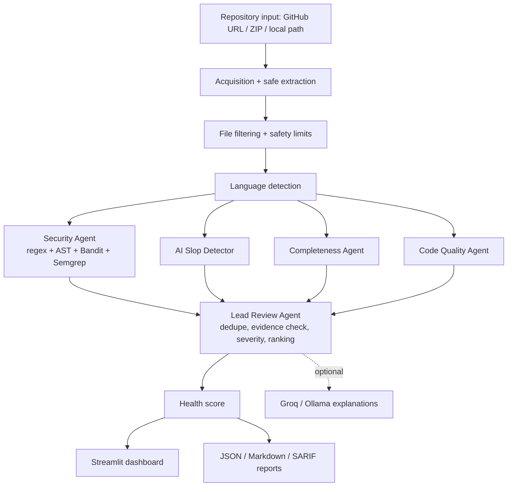

# 🛡️ CodeSentinel AI

**Secure. Inspect. Improve.**

CodeSentinel AI is a privacy-first, architecture-agnostic repository analysis agent. It scans a codebase for security vulnerabilities, incomplete implementations, dead code, maintainability problems and "AI slop" smells, then produces a prioritized, evidence-backed report. It runs fully locally and deterministically; AI explanations are optional.

## Features

- **Five logical agents** coordinated by one lightweight orchestrator (plain Python modules, no distributed system):
  | Agent | What it does |
  |---|---|
  | Security | Hardcoded secrets, SQL/command injection, unsafe deserialization, XSS patterns, insecure config. Runs **Bandit** (Python) and **Semgrep** (if installed and configured). |
  | AI Slop Detector | Generic/empty exception handling, meaningless wrappers, structurally duplicated functions, redundant comments, filler strings, thin abstractions. |
  | Completeness | TODO/FIXME, `pass`/`NotImplementedError` stubs, placeholder returns, unfinished API endpoints, empty files, missing tests/README/manifest. |
  | Code Quality | Long/complex/deeply nested functions, duplicate blocks, unused imports, dead and unreachable code, naming, mutable defaults. |
  | Lead Review | Deduplicates, re-verifies evidence on disk, classifies severity, assigns confidence, ranks, computes the health score. |
- **Languages:** Python (AST-level analysis), JavaScript, TypeScript, Java, C, C++, Go, PHP (pattern-level analysis); language-independent checks apply to everything.
- **Inputs:** public GitHub URL, uploaded ZIP, local path (opt-in, see below).
- **Reports:** JSON, Markdown, SARIF 2.1.0 (usable in GitHub code scanning / IDEs).
- **Honest labelling:** every finding is tagged **static analysis** (Bandit/Semgrep/AST/marker match) or **heuristic** (pattern-based, needs human review), plus a confidence score and an "evidence verified" flag. Nothing is presented as a confirmed exploit, and AI-slop findings never claim code *was* AI-written.

## Privacy and safety

- Local-first. No API keys required. Deterministic mode is the default.
- Scanned code is **never executed, imported or built**; no install scripts run; GitHub repos are fetched as ZIP archives (no git hooks).
- ZIP extraction blocks path traversal, absolute paths, symlinks, oversized archives and compression bombs.
- File-size, repository-size and file-count limits.
- Optional AI (Groq cloud or Ollama local) receives only a finding title and one redacted evidence line, never whole files. Findings in `.env`/key files and all secret findings are never sent.
- Secrets are masked in evidence, titles, reports and logs. API keys live in session memory only and are never displayed or written to reports.
- Temporary files are deleted after each scan. Nothing is persisted unless you enable "retain source".

## Architecture



A failing analyzer is recorded and skipped; the rest of the scan continues.

## Technology stack

Python 3.11+, Streamlit, Python `ast`, Bandit, optional Semgrep, regex rules, standard-library HTTP for optional Groq/Ollama. No database, no Docker, no paid services.

## Quick start

```bash
git clone https://github.com/<your-username>/CodeSentinel-AI.git
cd CodeSentinel-AI
python -m venv .venv && source .venv/bin/activate   # Windows: .venv\Scripts\activate
pip install -r requirements.txt
streamlit run app.py
```

Run the tests:

```bash
pip install pytest
python -m pytest -q
```

Scan from Python without the UI:

```python
from core.scanner import scan
from core.report_generator import to_markdown
print(to_markdown(scan("local", "sample_project")))
```

Optional: set `GROQ_API_KEY` (see `.env.example`) or enter it in **Settings**. Local-path scanning is hidden by default (it would expose the server's filesystem when hosted); enable it on your own machine with `CODESENTINEL_ALLOW_LOCAL=1`.

## Example scan result

Scanning the bundled `sample_project/` (synthetic, intentionally insecure, fake credentials only) with Semgrep disabled:

```
Repository: sample_project        Health: 21/100   Quality: 49/100
Files scanned: 5 (Python 2, PHP 1, JavaScript 1)
Findings: 52  ->  6 CRITICAL · 9 HIGH · 10 MEDIUM · 27 LOW
  Security 16 · Completeness 11 · Code Quality 21 · AI Slop 4
  26 from static analysis, 26 heuristic

CRITICAL  app.py:20   Potential SQL injection (string-built query)   95%  static-analysis
CRITICAL  app.py:27   Starting a process with a shell (os.system)    95%  static-analysis
CRITICAL  app.py:11   AWS access key ID (masked)                     90%  heuristic
HIGH      app.py:39   Incomplete API endpoint 'report'               85%  static-analysis
HIGH      login.php:4 Potential SQL injection (user input in query)  75%  heuristic
```

## Screenshots

> Add screenshots after your first run: `docs/dashboard.png`, `docs/findings.png`, `docs/agents.png`.

| Dashboard | Findings | Agent insights |
|---|---|---|
| _placeholder_ | _placeholder_ | _placeholder_ |

## Deployment

See [DEPLOYMENT.md](DEPLOYMENT.md) for Streamlit Community Cloud and GitHub steps.

## Limitations

- Static analysis only. Regex/heuristic findings can be false positives or negatives; always review before acting. Non-Python languages get pattern-level checks, not data-flow analysis.
- Bandit covers Python only. Semgrep is optional and only runs when installed **and** a rules config (path or pack such as `p/security-audit`) is set in Settings. Registry packs download rules over the network; source code is not uploaded.
- Dead-code detection is name-based and can miss dynamic usage (reflection, `getattr`, external callers).
- Complexity, length and nesting for non-Python languages are brace-counting estimates.
- Dependency vulnerability (CVE) scanning is not included.
- GitHub support is public repositories only, subject to GitHub rate limits; large repositories hit the size limits and are partially scanned with a warning.
- Results are held in memory per browser session; there is no scan history across sessions.

## Future improvements

Dependency/CVE checks (OSV), Tree-sitter for deeper multi-language analysis, taint tracking, baseline/diff scans for pull requests, GitHub Action output, persisted history (optional SQLite), more secret formats and entropy checks.

## License

MIT, see [LICENSE](LICENSE).
